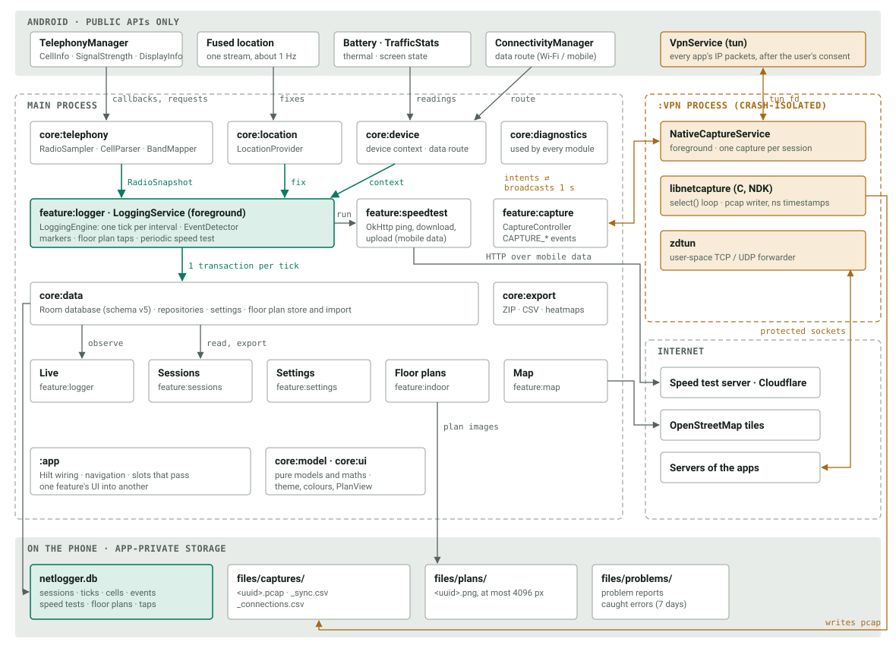
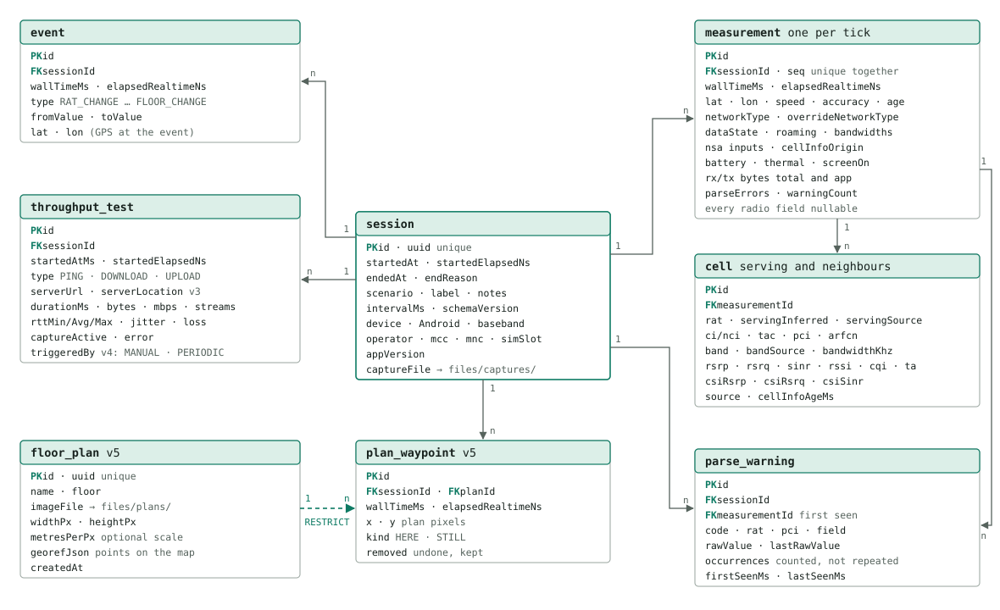
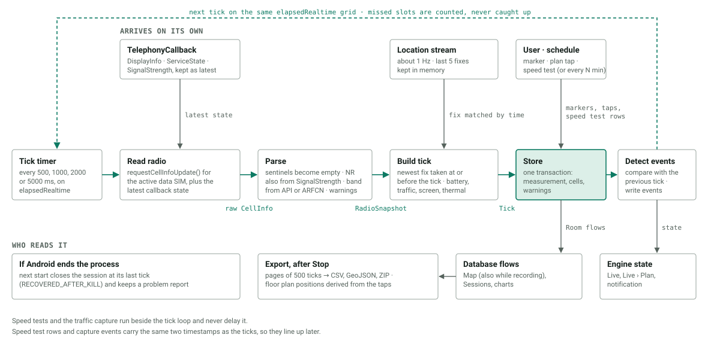

# Architecture

Three views of NetLogger, drawn from the code (release 0.4.0, database schema v5): which parts run where and talk to
what, how the database is laid out, and what happens during one tick of a recording. Column definitions and units are
in [`columns.md`](columns.md); design decisions in [`decisions/`](decisions/).

## System architecture

Radio, location and device readings flow down into the logging engine, which writes each tick to the database in one
transaction; the screens only read. The traffic capture lives in its own process (amber), so a crash in the C code
cannot end a recording.

- Features never depend on each other. Where one feature's UI appears inside another (the capture row on Live, the
  floor plan pages inside Settings), `:app` passes it in.
- Only `core:telephony` calls `TelephonyManager`; parsers in `core:telephony` and maths in `core:model` are pure Kotlin
  and unit-tested on the JVM.
- The capture process writes no database rows: it reports packet counters once a second and its end once, and the main
  process stores them as `CAPTURE_STARTED` / `CAPTURE_STOPPED` events.
- Network use is limited to map tiles, the speed test server (or Cloudflare) and, while capturing, the apps' own
  traffic. Core logging needs no network.

## Database (Room, schema v5)

Everything hangs off `session`, and deleting a session deletes all its rows (ON DELETE CASCADE, solid lines). The one
exception is the dashed link: a floor plan used by any tap cannot be deleted, so old sessions never lose the plan their
positions refer to.

- Every row has both `wallTimeMs` and `elapsedRealtimeNs`; the second is immune to clock changes and is the key that
  lines ticks up with pcap packets.
- Tick positions on a floor plan are never stored. They are derived from `plan_waypoint` when shown or exported, so a
  better method later also applies to old sessions.
- A parse anomaly is stored once per session, code, cell and field, with a counter, instead of once per tick.
- Schema history: v1 frozen at the first field session; v2 speed tests; v3 `serverLocation`; v4 `triggeredBy`; v5 floor
  plans. Each step has a tested migration (`core/data/src/test/.../SchemaTest.kt`, schemas in `core/data/schemas/`).

## One tick, from the modem to the database

Each tick runs the same six steps in one coroutine. Everything that arrives on its own (callbacks, GPS, user actions)
is only read at the moment the tick needs it, and each GPS fix is matched to the tick by time, so a late fix never
lands on an earlier tick.

- A missing or faked value (`Int.MAX_VALUE`, `UNAVAILABLE`) is stored as empty, and a getter that throws is counted in
  `parseErrors`; logging never stops for a bad field.
- Each cell keeps its age (`cellInfoAgeMs`), because Android may answer with cached data, especially with the screen
  off.
- The service holds a wake lock only while recording and uses one location stream; there is no busy loop.

## Updating these diagrams

The SVG files are hand-drawn. When a module, table or step changes, edit the drawing in the same commit, keep the
captions above in sync, and check the files on GitHub (they render as images there, with their own embedded styles and
system fonts).
